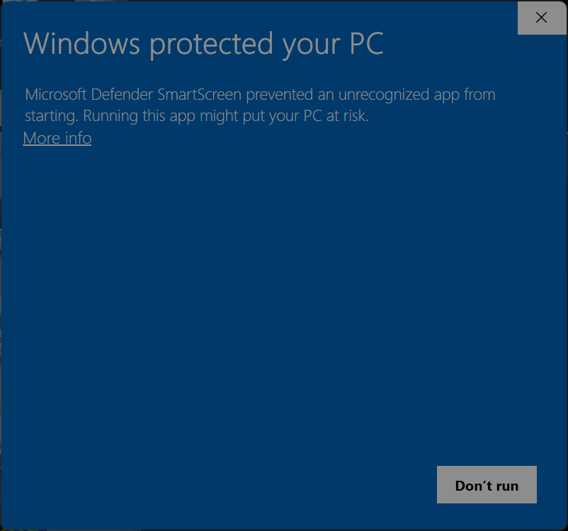
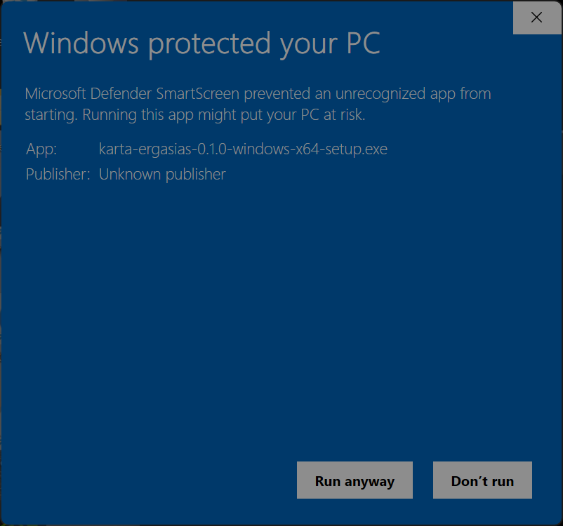

# Εγκατάσταση σε Windows

Χρειάζεστε Windows 10 ή 11, 64-bit, και δικαιώματα διαχειριστή για την εγκατάσταση. [Επιλέξτε το αρχείο της έκδοσης](download.md): `karta-ergasias-<έκδοση>-windows-x64-setup.exe`.

1. Κατεβάστε το μόνο από τη σελίδα εκδόσεων του έργου και ανοίξτε το.
2. Αν δείτε **«Τα Windows προστάτευσαν τον υπολογιστή σας»**, επιλέξτε **«Περισσότερες πληροφορίες» → «Εκτέλεση ούτως ή άλλως»** (*More info → Run anyway*).

3. Στο «Να επιτρέπεται να κάνει αλλαγές;» επιλέξτε **Ναι**, έπειτα Επόμενο → Εγκατάσταση → Τέλος με το άνοιγμα της Κάρτας Εργασίας επιλεγμένο.
4. Η ρύθμιση ανοίγει στον browser στο `http://127.0.0.1:8881`. Συνεχίστε με [χρήστες, PIN και συσκευές](access.md).

Το πρόγραμμα δεν έχει πληρωμένο πιστοποιητικό Microsoft. Η υπογραφή των ενημερώσεων με το κλειδί του έργου είναι χωριστός έλεγχος· ο πρώτος εγκαταστάτης δεν ελέγχεται αυτόματα από ήδη εγκατεστημένη εφαρμογή.

## Για να χτυπούν και τα κινητά

Ρυθμίσεις → Δίκτυο και Internet → Wi-Fi ή Ethernet → το προστατευμένο δίκτυο του ιατρείου → **Ιδιωτικό**. Ο εγκαταστάτης ανοίγει τη θύρα 8880 στο τοπικό ιδιωτικό/εταιρικό δίκτυο και την κλείνει στα δημόσια. Άλλη θύρα χρειάζεται τεχνική ρύθμιση.

Το πρόγραμμα ξεκινά όταν συνδεθείτε στα Windows. Μην κλείνετε τον υπολογιστή πριν φύγει το προσωπικό. Δείτε [ενημερώσεις](updates.md) για τις ειδικές περιπτώσεις του Node.js και [αντιμετώπιση προβλημάτων](troubleshooting.md) αν το κινητό δεν συνδέεται.
