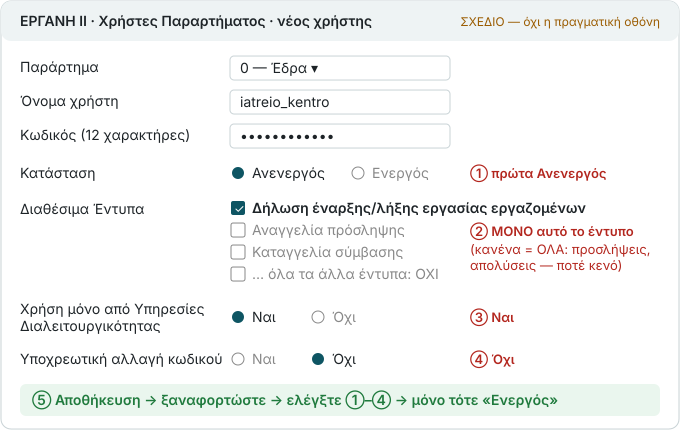

# Restricted users, PINs and devices

## One ΕΡΓΑΝΗ user per branch

With the accountant or owner who holds the master credentials, in the ΕΡΓΑΝΗ portal:

1. Χρήστες Παραρτήματος → new user for the correct branch. Create it **Inactive (Ανενεργός)**.
2. Username: 8–20 Latin characters. Password: 8–12 characters from letters, digits and `. _ ! #`; choose a random 12-character password. It does not change or expire.
3. Available forms (Διαθέσιμα Έντυπα): select **only “Δήλωση έναρξης/λήξης εργασίας εργαζομένων”**. Save and reload to verify. **Selecting no form grants all forms**, not no rights.
4. “Χρήση μόνο από Υπηρεσίες Διαλειτουργικότητας”: **Yes** (API only). Mandatory password change: **No**.
5. Activate only after verifying those settings. Keep the password in a password manager, not a message or reception note.

Master credentials are used only in the portal to create the restricted user. The program receives the restricted user (type 02). Details: [ERGANI-USER.md](../../ERGANI-USER.md) (Greek).

## First setup

On the installation computer open `http://127.0.0.1:8881`. Read the terms; enter the employer, branches and their restricted logins. Choose the practice's private address and port 8880. Production requires explicit confirmation. Set an owner password of at least 10 characters; keep it from staff.

The [connection check](connection-check.md) only reads: it confirms sign-in, an offered form and, where enabled, one schedule read. **It does not prove filing rights, card-only scope, API-only access or the correct branch.** Verify those in the portal and record your human confirmation on the check page. Master credentials stay in the portal.

## Staff and their personal PIN

Προσωπικό → new employee, using the details recorded in ΕΡΓΑΝΗ. Hand over the temporary four-digit PIN in person. On the staff page, the employee selects their name, enters the temporary PIN, chooses their own PIN twice, then selects **Άκυρο (Cancel)** before arrival/departure: the PIN changes without filing. They do not share it with the owner. It works across branches.

Five wrong attempts lock access for ten minutes. If the PIN is forgotten, the owner issues a new temporary PIN; that reset is recorded as the owner's action.

## Enrol each device

Συσκευές → new device: choose its branch. The link/QR is single-use and lasts 30 minutes. Open it on the device that will stamp. **Each device needs a fresh link**, not the already used QR. Bookmark the staff page. Revoke a lost device from the list.

With Docker, use `admin add`, `admin pin`, `admin enroll --branch N --label "Reception"`, `admin devices`, `admin revoke-device --id N`: [ADMIN.md](../../ADMIN.md) (Greek).
